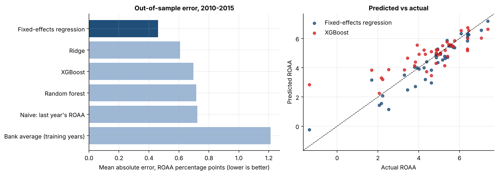
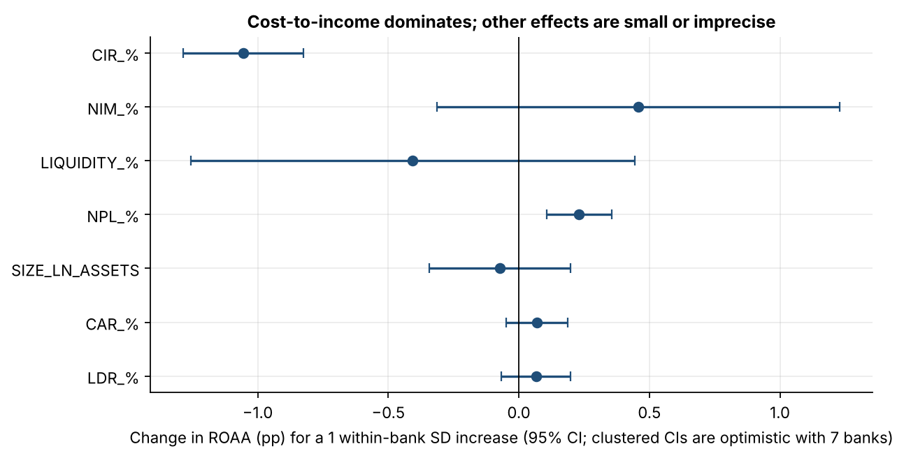

# Determinants and Prediction of Commercial Bank Profitability in Kenya (2004–2015)

**An econometric and machine-learning comparison on a panel of seven Kenyan banks.**

What drives bank profitability in Kenya, and do machine-learning models predict it better than a conventional fixed-effects regression? I tested both approaches on 84 bank-years of data (7 banks × 12 years), evaluating every predictive model **out of time**, and found that a well-specified regression beats XGBoost and random forest on this data.

**Tools:** Python · pandas · statsmodels · linearmodels · scikit-learn · XGBoost · SHAP · matplotlib

📓 **Full analysis:** [`notebooks/kenya_bank_profitability.ipynb`](notebooks/kenya_bank_profitability.ipynb) (also as [HTML](kenya_bank_profitability.html))

---

## Key findings

| # | Finding | Evidence |
|---|---|---|
| 1 | **Cost-to-income ratio (CIR) is the one robust driver of ROAA.** | Fixed-effects coefficient −0.24 (wild-cluster-bootstrap p = 0.008); a 1 within-bank SD (4.5 pt) rise in CIR ≈ 1.1 pt lower ROAA. Holds in all six specifications. |
| 2 | **The positive NPL coefficient is not robust**, so I do not interpret it causally. | Bootstrap p = 0.058; p = 0.57 when NBK is excluded; negative raw ROAA–NPL correlation within 6 of 7 banks. |
| 3 | **A fixed-effects regression predicts better than machine learning.** | Out-of-sample MAE 0.46 (fixed effects) vs 0.61 (ridge), 0.70 (XGBoost), 0.72 (random forest); R² 0.85 vs 0.62–0.73. |
| 4 | **SHAP agrees that CIR dominates** but overstates bank size. | CIR = 61% of XGBoost importance; size = 15% in XGBoost vs 3% in the regression, probably because trees use size to tell banks apart. |
| 5 | **The early-warning classifier and forecasts are not good enough to use.** | Classifier AUC 0.68 vs 0.74 for a "distress persists" rule (only 6 test events); naive forecast MAE 0.72 beats ARIMA (0.81–0.85). |

Reporting results that did not work is deliberate: with 7 banks and 84 observations, the honest conclusion is that simple models win and predictive claims are not supported.





## Method in brief

1. **Data audit.** Balanced panel, no duplicates or gaps; the loan-to-deposit ratio and log-assets reproduce from the KSh columns to within rounding.
2. **Panel regression.** Bank fixed effects (and bank + year effects). With only 7 clusters, standard errors clustered by bank are unreliable, so I also report heteroskedasticity-robust and **wild cluster bootstrap** (Webb weights) p-values.
3. **Robustness.** Six specifications, including dropping the collinear NIM and liquidity ratios, excluding the most extreme bank, and restricting to 2008–2015.
4. **Machine learning.** Expanding-window, out-of-time evaluation (train on years before *t*, test on year *t*, 2010–2015; 42 predictions) against naive, bank-average and fixed-effects baselines. Hyperparameters fixed in advance, not tuned, and a paired Wilcoxon test on errors.
5. **Explainability.** SHAP values compared with the regression's standardised effects.
6. **Clustering, early warning, forecasting.** Each evaluated honestly against simple benchmarks.

## Repository structure

```
├── data/
│   ├── bank_data.csv             # 84-row panel (7 banks x 2004-2015)
│   └── DATA_DICTIONARY.md        # variable definitions and sources
├── notebooks/
│   └── kenya_bank_profitability.ipynb
├── results/                      # tables exported by the notebook (CSV)
├── figures/                      # charts exported by the notebook
├── kenya_bank_profitability.html # the executed notebook, readable in a browser
└── requirements.txt
```

## Reproduce

```bash
pip install -r requirements.txt
cd notebooks
jupyter notebook kenya_bank_profitability.ipynb   # Run All
```

The notebook runs in under a minute. Random seeds are fixed.

## Data

Annual bank-level data compiled from secondary sources: Central Bank of Kenya Bank Supervision Annual Reports, the banks' audited annual reports and Nairobi Securities Exchange publications. See [`data/DATA_DICTIONARY.md`](data/DATA_DICTIONARY.md).

## Limitations

- Seven large, long-established banks and 84 observations: low statistical power, and results may not generalise to smaller banks.
- Associations, not causal effects. Cost-to-income and ROAA are partly mechanically related.
- The sample ends in 2015, before the 2016 interest-rate cap.
- Data are compiled secondary data; internal consistency was checked, but each figure was not re-verified against the source reports.

## Author

Timothy Rimu
